### I build and look after websites that need to work every day.

I'm a web developer with about three years of experience across WordPress, custom PHP, Elementor, Webflow and Node.js. Right now I'm a **Sr. Designer and Developer at [Abbot Technologies](https://abbottechnologies.com/)**, working on Elementor sites, React apps connected to WordPress, payment gateways, and automation in n8n and GoHighLevel.

| **50+** | **45+** | **450+** | **60%** |
|:---:|:---:|:---:|:---:|
| live websites maintained | custom PHP sites built from scratch | visual assets designed | traffic growth on SEO pages |

## What I work on

- **WordPress & Elementor:** full site builds and redesigns, tuned for page speed and usability
- **Custom PHP & themes:** core-PHP WordPress themes written from scratch
- **React & integrations:** React apps connected to WordPress, payment gateways, REST APIs and login flows
- **SEO & performance:** on-page and technical SEO, site structure and speed work
- **Automation:** n8n workflows and GoHighLevel templates that save manual work
- **Testing & fixes:** cross-browser and cross-device testing, clear bug reports, and the fixes that follow

## Tools I use

                 

## Selected work

| Project | Built with | What it is |
|---|---|---|
| [BullStreetEdge](https://bullstreetedge.com/) | WordPress, React, PHP | Trading platform website, integrated with its React web app |
| [Monk Technologies](https://monktechnologies.net/) | WordPress, Elementor | Website for a technology company in Noida |
| [Quality Roofs & Exteriors](https://qualityroofsandexteriors.com/) | WordPress, Elementor | Website for a roofing and exteriors contractor in Delaware |
| [Clearway Exteriors](https://clrwy.com/) | WordPress, Elementor | Website for a roofing and exteriors contractor in Illinois |

## On GitHub

- [**Himanshu-Singh-Portfolio**](https://github.com/HimanshuPharswan/Himanshu-Singh-Portfolio): my portfolio site, written in plain HTML, CSS and JavaScript
- [**QR-CodeScanner**](https://github.com/HimanshuPharswan/QR-CodeScanner): scans QR codes from a live video feed in the browser
- [**QR-CodeGenerator**](https://github.com/HimanshuPharswan/QR-CodeGenerator): turns typed content into a QR code
- [**Random_Password_Generator**](https://github.com/HimanshuPharswan/Random_Password_Generator): a Python random password generator

## Let's connect

Open to freelance work. Email or LinkedIn is the quickest way to reach me about a project.

 
